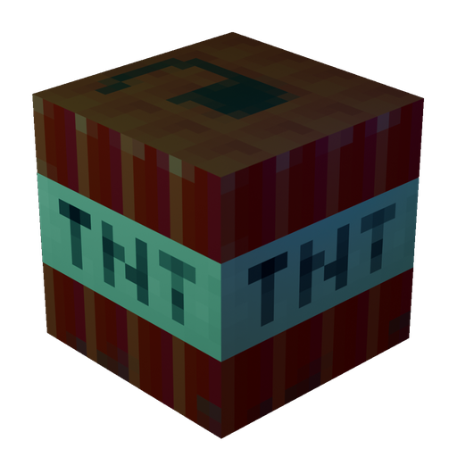
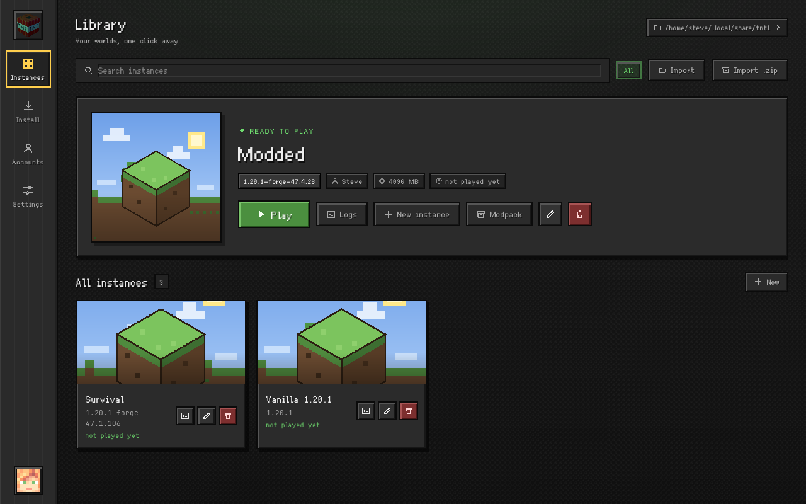
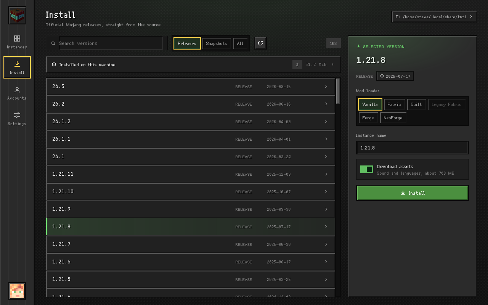
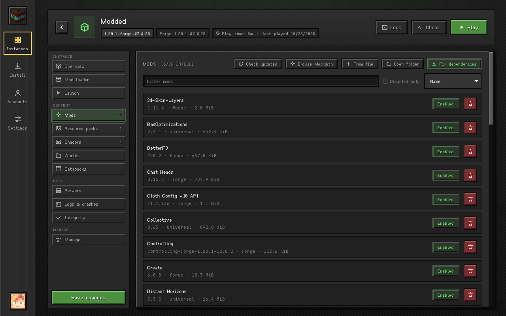
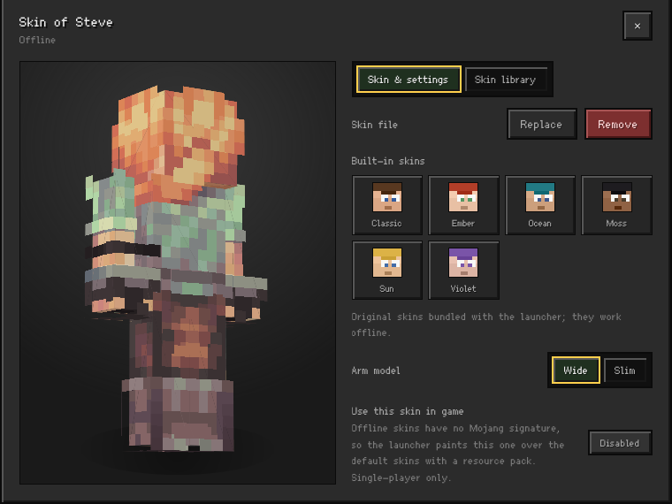

# TNTL — TNT Launcher

<p align="center">
  
</p>

<p align="center">
  <a href="https://buymeacoffee.com/busybin"></a>
</p>

TNTL stands for **TNT Launcher**. It is a Minecraft launcher for **Windows and
Linux**, built from scratch: a Rust core, a headless CLI and a Tauri 2 desktop
shell. It is in beta, and the current release is a test build.

Status: the core installs vanilla, Fabric, Quilt, Legacy Fabric, Forge and
NeoForge versions from the official upstreams and launches them, including
legacy versions before 1.13. Mods and their required
dependencies can be installed from Modrinth or CurseForge; modpacks, resource
packs and shaders are supported too. The desktop shell also manages worlds, servers,
crash reports, screenshots, instance archives and per-instance settings, with
an account list that carries skins and capes and a 3D preview. The log window
filters by level, lists problems and explains common crashes; the instance page
checks mods, loader and game versions, Java, memory and missing files without
starting the game.
Tested end to end on Linux with 1.20.1, through both the CLI and the desktop
shell.

- Rust workspace in `crates/`; the CLI is `tntl-cli`, binary `tntl`; the shared
  service layer is `tntl-app`.
- Desktop shell: Tauri 2 + Vue 3 under `apps/desktop`.
- CurseForge needs an API key from your own developer account; the launcher
  never bundles one. See [Content sources](#content-sources).
- Official upstreams only. No mirror list, no source picker, no region
  detection; every host is listed in [`docs/02-endpoints.md`](docs/02-endpoints.md).
- Scope: [`docs/00-scope.md`](docs/00-scope.md)
- Architecture: [`docs/01-architecture.md`](docs/01-architecture.md)
- Development workflow: [`docs/05-workflow.md`](docs/05-workflow.md)

## Screenshots

| Instance library | Install a version |
| --- | --- |
|  |  |

| Instance content | Accounts and skins |
| --- | --- |
|  |  |

## Try it

Desktop shell (needs `webkit2gtk-4.1`, Node and Rust):

```sh
cd apps/desktop
pnpm install
pnpm tauri dev
```

Or use the CLI (built from source; the release page ships the desktop app):

```sh
cargo run -p tntl-cli -- install 1.20.1     # download from Mojang and create an instance
cargo run -p tntl-cli -- verify 1.20.1      # every file is present and hashed
cargo run -p tntl-cli -- launch 1.20.1
cargo run -p tntl-cli -- loaders 1.20.1     # Fabric builds published for 1.20.1
cargo run -p tntl-cli -- install 1.20.1 --loader fabric   # instance 1.20.1-fabric
cargo run -p tntl-cli -- install 1.20.1 --loader forge    # installer based loaders too
cargo run -p tntl-cli -- install 1.21.1 --loader neoforge # needs Java 21
cargo run -p tntl-cli -- install 1.8.9 --loader legacyfabric
cargo run -p tntl-cli -- java --offers                     # Mojang runtimes and Temurin JDKs
cargo run -p tntl-cli -- java --install adoptium-21
cargo run -p tntl-cli -- mods 1.20.1-fabric               # list, --disable / --enable
cargo run -p tntl-cli -- search sodium --instance 1.20.1-fabric
cargo run -p tntl-cli -- add iris 1.20.1-fabric           # also installs required dependencies
cargo run -p tntl-cli -- deps 1.20.1-fabric               # install missing deps by exact Modrinth slug
cargo run -p tntl-cli -- deps 1.20.1-fabric --fix-versions # replace deps outside a required range
cargo run -p tntl-cli -- updates 1.20.1-fabric            # mods; --kind resourcepack|shader for the rest
cargo run -p tntl-cli -- content 1.20.1-fabric --kind resourcepack   # list, --enable / --disable one
cargo run -p tntl-cli -- modpack ./pack.mrpack            # new instance from a .mrpack
cargo run -p tntl-cli -- cfpack 123456 --name pack        # CurseForge modpack by project id
cargo run -p tntl-cli -- pack 1.20.1-fabric               # newer build of the pack, --apply
cargo run -p tntl-cli -- worlds 1.20.1-fabric             # list worlds, --backup/--import/--delete/--duplicate
cargo run -p tntl-cli -- add-file 1.20.1-fabric mod.jar   # --kind resourcepack|shader for zips
cargo run -p tntl-cli -- duplicate 1.20.1-fabric copy     # copy an instance
cargo run -p tntl-cli -- export 1.20.1-fabric -o pack.mrpack
cargo run -p tntl-cli -- archive 1.20.1-fabric -o inst.zip
cargo run -p tntl-cli -- import-archive inst.zip --name copy
cargo run -p tntl-cli -- accounts --add-offline Steve     # list, --use ID / --remove ID
cargo run -p tntl-cli -- skin Steve --set skin.png --model slim --apply on
cargo run -p tntl-cli -- login                            # Microsoft device code flow
cargo run -p tntl-cli -- ping play.example.net
cargo run -p tntl-cli -- packs fabulously                 # search Modrinth modpacks
cargo run -p tntl-cli -- packs --install 1KVo5zza --name FO
cargo run -p tntl-cli -- ftb skies                        # search the FTB catalogue
cargo run -p tntl-cli -- ftb --pack 103                   # versions of one FTB pack
cargo run -p tntl-cli -- ftb --install 103 --name skies   # newest build, or --version <id>
cargo run -p tntl-cli -- servers 1.20.1-fabric            # --add "Name|host:port" / --remove INDEX
cargo run -p tntl-cli -- crashes 1.20.1-fabric            # --show FILE / --delete FILE
cargo run -p tntl-cli -- check 1.20.1-fabric              # offline instance health check
cargo run -p tntl-cli -- analyze logs/latest.log          # log/crash report analysis
cargo run -p tntl-cli -- screenshots 1.20.1-fabric        # --delete FILE
cargo run -p tntl-cli -- disk 1.20.1-fabric               # sizes of the instance and shared files
cargo run -p tntl-cli -- cleanup 1.20.1-fabric            # remove logs, crash reports and natives
cargo run -p tntl-cli -- meta 1.20.1-fabric --group Packs --notes "..." --icon icon.png
```

## Content sources

Modrinth works out of the box. CurseForge answers only with a developer key:

1. Create a key in the CurseForge developer console
   ([console.curseforge.com](https://console.curseforge.com/?#/api-keys)) and
   accept their terms.
2. Paste it in Settings → CurseForge, or export `TNTL_CURSEFORGE_API_KEY`.

The key is only sent in the `x-api-key` request header. Files whose author
disabled third-party downloads are reported by name and have to be fetched from
the CurseForge website. CurseForge modpacks, FTB packs and `.mrpack` files are
all installed; Technic and ATLauncher packs are not.

```sh
tntl search sodium --instance 1.20.1-fabric --source curseforge
tntl add 394468 1.20.1-fabric --source curseforge   # project id or slug
```

## Accounts and skins

Offline accounts need no sign-in. The account list lives in
`<root>/accounts.json`; an instance either pins one account or uses the active
one.

Microsoft sign-in uses the device code flow, so it needs a public Entra client
id with that flow enabled. Set it in Settings or `TNTL_MSA_CLIENT_ID`; the
launcher never sees a password. Uploading a skin or switching a cape goes
through the official Minecraft services API; the 3D preview uses the cached PNG.

Looking up someone else's skin queries Mojang first, then
[ely.by](https://ely.by) when Mojang has no texture; the skin library in the
dialog is a browse list from [MineSkin](https://mineskin.org). Both run only
when you ask for them, and neither is Mojang.

Offline skins have no Mojang signature, so vanilla clients ignore them. With
"Use this skin in game" the launcher writes `resourcepacks/tntl-skin.zip`, which
replaces the default skins; that only makes sense in single-player or on a
server where the other players also use default skins.

The interface ships in English, Chinese, Spanish, French, Arabic (right to
left), Portuguese, Russian and Japanese; pick one under Settings.

The data directory defaults to the platform data dir (`~/.local/share/tntl`
on Linux, `%APPDATA%\tntl` on Windows). Override it with `--root` or
`TNTL_ROOT`. `tntl import <path-to-.minecraft>` registers an existing installation
instead of downloading. Pointing `tntl import` at a Prism Launcher or MultiMC
instance folder copies its game directory and installs the version and loader
from `mmc-pack.json`.

## License

Free software under the GNU General Public License v3.0 or later. See
[`LICENSE`](LICENSE) and [`docs/03-licensing.md`](docs/03-licensing.md).
The name and logo are covered separately by [`TRADEMARK.md`](TRADEMARK.md).

Only Windows and Linux are supported; this project is not affiliated with
Mojang Studios or Microsoft.

## Known limitations

- Windows builds are produced by cross-compiling and have not been run on a
  real Windows machine yet; Windows shows an unknown-publisher prompt when the
  installer starts.
- Microsoft sign-in needs a client id from your own Entra app registration.
- Self-update from GitHub Releases is not implemented.
- Technic and ATLauncher packs are not supported.
- OptiFine can only be dropped in by hand; only its shader switch is managed.
